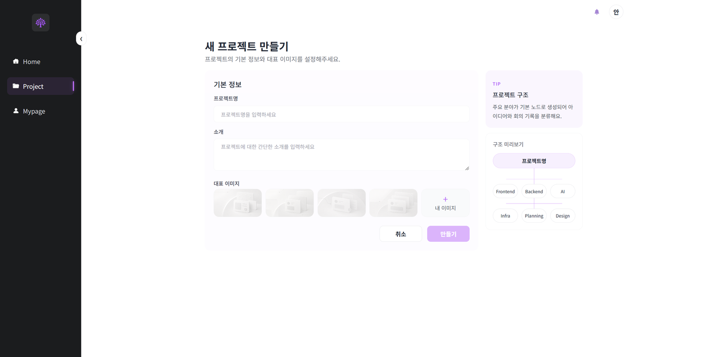
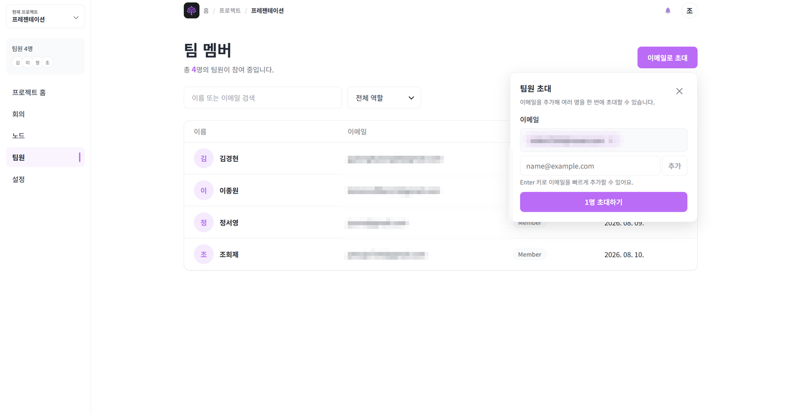
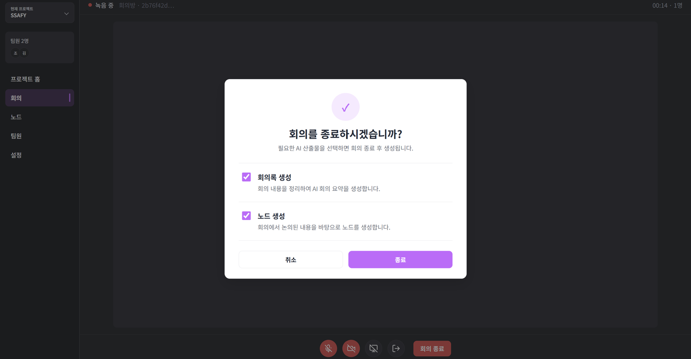
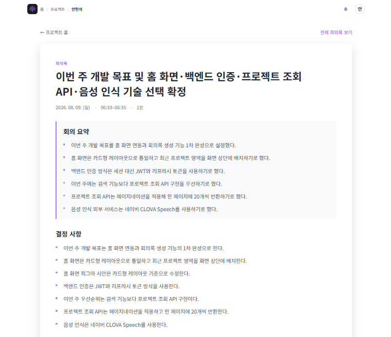
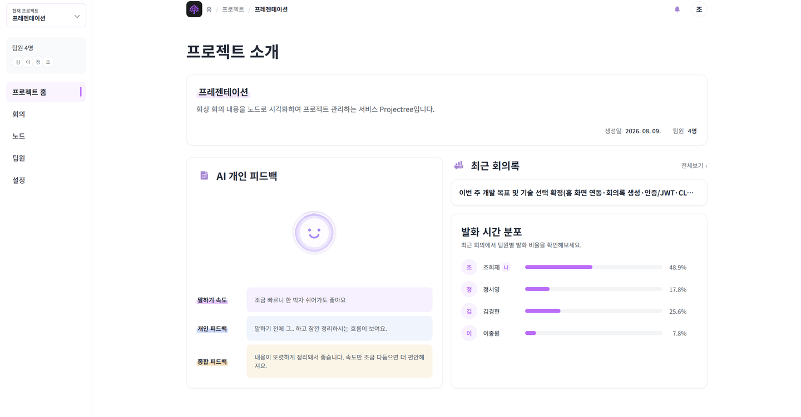

# 🌳 Projectree — 화상 회의기반 노드 시각화 플랫폼

> 회의를 AI로 지식화하고, 프로젝트의 의사결정 흐름을 노드로 연결합니다.

화상 회의 음성을 AI를 통해 회의록을 만들고, 결정·작업·이슈를 **3D 그래프**로 시각화하여 프로젝트 관리하는 서비스

---
## 🚀 주요 기능

<table>
  <tr>
    <td align="center" width="50%">
      <b>프로젝트 생성</b><br><br>
      <br>
      프로젝트명, 소개, 대표 이미지를 입력받아<br>프로젝트를 생성
    </td>
    <td align="center" width="50%">
      <b>팀원 초대</b><br><br>
      <br>
      이메일로 여러 명의 팀원을 한 번에 초대
    </td>
  </tr>
  <tr>
    <td align="center" width="50%">
      <b>실시간 녹음 화상 회의</b><br><br>
      <br>
      화상 회의를 진행하며 음성을 자동으로 녹음
    </td>
    <td align="center" width="50%">
      <b>회의 종료 후 AI 산출물 선택</b><br><br>
      <br>
      회의를 마치면 필요한 산출물<br>(회의록·노드)을 골라 생성
    </td>
  </tr>
  <tr>
    <td align="center" width="50%">
      <b>AI 회의록</b><br><br>
      <br>
      회의 음성을 텍스트로 바꾸고<br>요약·결정 사항·다음 할 일을 자동 정리
    </td>
    <td align="center" width="50%">
      <b>3D 노드 시각화</b><br><br>
      <br>
      회의에서 나온 결정·작업·이슈를<br>노드로 연결해 프로젝트 흐름을 한눈에 확인
    </td>
  </tr>
  <tr>
    <td align="center" colspan="2">
      <b>AI 개인 피드백</b><br><br>
      <br>
      참석자별 발화를 분석해 말하기 속도·습관 피드백과 팀원별 발화 비율 제공
    </td>
  </tr>
</table>

---
## 🛠️ 기술 스택

### Frontend
- React, TypeScript, Vite
- Zustand, React Router
- three.js, React Three Fiber (3D 노드 그래프)

### Backend
- Java 21, Spring Boot, Spring Data JPA, QueryDSL
- Python, FastAPI, SQLAlchemy
- MySQL, PostgreSQL(pgvector), Redis
- Naver Clova Speech(STT), LLM(GMS), ffmpeg

### Infra
- AWS ECS Fargate, EC2, RDS, S3, SQS, ALB, Route 53, VPC
- OpenVidu (화상 회의 서버)
- Upstash Redis, Jenkins, Vercel

---
## 🏗️ 시스템 아키텍처


1. **화상 회의** — OpenVidu 3를 별도 EC2로 분리해 WebRTC 화상 회의/녹음을 처리
2. **파이프라인** — 녹음 오디오를 Mixed-Audio Queue / Personal-Audio Queue(SQS) 두 개로 나눠 비동기 처리
   - Mixed-Audio Queue → EC2 FastAPI Worker → Naver Clova STT → LLM 분석 → 회의록·노드 그래프 생성
   - Personal-Audio Queue → EC2 Spring AI Worker → OpenAI 호환 API → 개인별 피드백 생성

---
### 커밋 메시지 타입 프리픽스                                                                                                                                                                                                                                                                                                                                         
| 타입 | 용도 |                                                                                                                                                       
| --- | --- |                                                                                                                                                         
| `feat:` | 새 기능 추가 |                                                                                                                                            
| `fix:` | 버그 수정 |                                                                                                                                                
| `test:` | 테스트 추가/수정 |                                                                                                                                        
| `chore:` | 빌드, 설정 등 잡무성 변경 |                                                                                                                              
| `refactor:` | 동작 변경 없는 리팩터링 |                                                                                                                             
| `style:` | 포맷팅, 세미콜론 등 코드 스타일 |                                                                                                                        
| `docs:` | 문서 변경 |                                                                                                                                               
| `ci:` | CI/CD 설정 변경 |
---
## Jira 활용 방식

### 이슈 계층 구조
`에픽(Epic) → 스토리(Story) → 하위 작업(Sub-task)` 3단계로 업무를 분해해 관리

- **에픽**: 기능 단위의 큰 묶음 (예: `사용자 인증`)
- **스토리**: 사용자 관점의 기능 (예: `소셜 로그인`, `로그아웃`, `회원 탈퇴`, `프로필 조회`)
- **하위 작업**: 실제 구현 단위 작업 (예: `[BE] 회원 탈퇴 API 만들기`)


---
## 📦 폴더 구조

```text
S15P11D205/
├─ Backend/                 # Spring Boot API 서버 (회원/프로젝트/회의/노드 도메인)
│  └─ src/main/java/com/ssafy/projectree/domain/
│     ├─ member/ project/ meeting/ meetingreview/ nodeCategory/ notification/ mail/ uploadfile/
├─ Frontend/                # React + Vite SPA
│  └─ src/page/             # Auth/ Home/ Landing/ MyPage/ Project(Create/Home/Meeting/Tree/Member/...)
├─ data-pipeline/            # Python FastAPI 기반 회의 분석·노드 생성 파이프라인
│  └─ data_pipeline/         # api/ meeting_analysis/ stt/ llm/ storage/ worker/ outbox_publisher/ ...
├─ personal-audio-backend/  # 개인별 회의 피드백 생성 Spring Boot 서버
│  └─ src/main/java/ssafy/personal_audio_backend/domain/review/
└─ exec/                     # 포팅 매뉴얼 등 실행/배포 산출물
```

## 📄 문서 / 트러블슈팅

- [메시징 큐 적용](docs/troubleshooting/messaging-queue.md)

## 👥 팀 소개

| 이름 | 역할 |
| --- | --- |
| 조희제 | Backend, Infra |
| 김경현 | Backend |
| 안현석 | FrontEnd, BackEnd |
| 이상민 | Infra |
| 이종원 | AI |
| 정서영 | FrontEnd |
